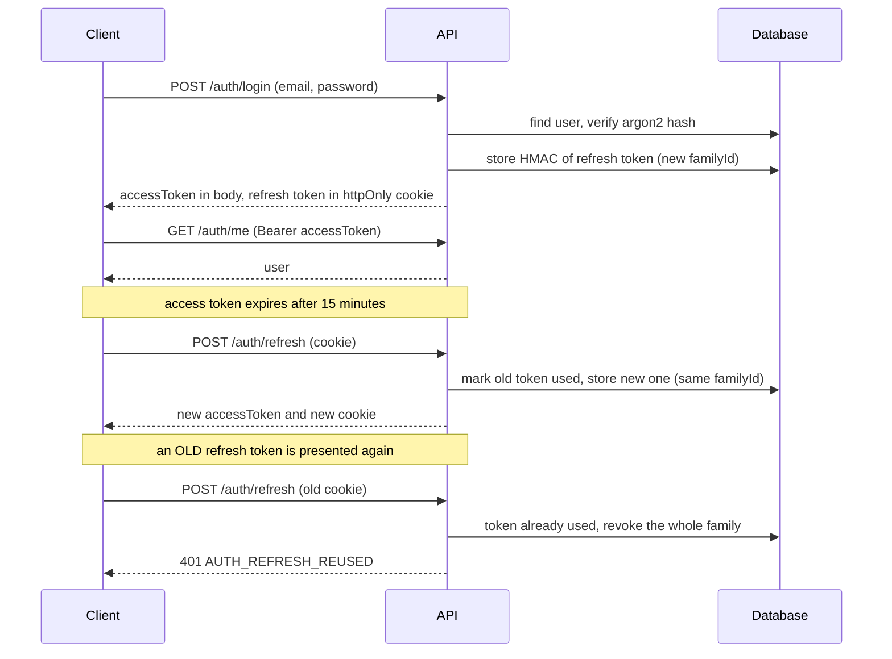

# Authentication flow

## Endpoints

| Endpoint | Purpose | Auth |
|---|---|---|
| `POST /api/v1/auth/register` | Create account and personal workspace | none |
| `POST /api/v1/auth/login` | Access token in body, refresh token in cookie | none |
| `POST /api/v1/auth/refresh` | Rotate refresh token, new access token | refresh cookie |
| `POST /api/v1/auth/logout` | Revoke the session family, clear cookie | refresh cookie |
| `GET /api/v1/auth/me` | Current user | Bearer access token |

See [ADR 0002](adr/0002-refresh-token-rotation.md) for the reasoning and limits.
